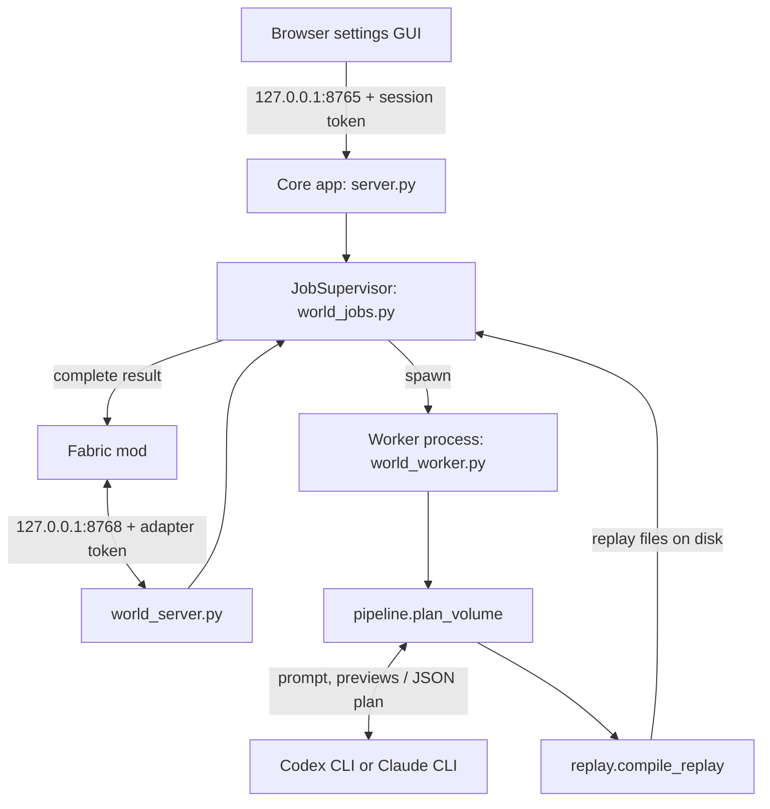

# Architecture

WorldPrompt is two programs that talk over loopback HTTP: the Fabric mod, which owns the world, and WorldPrompt Core, which owns planning. This page covers the components, how a job moves through them, process isolation, the security model and where Core keeps its files.

## Components

| Component | Language | Owns | Never does |
|---|---|---|---|
| Fabric mod (`fabric/`) | Java 25 | Selections, capture, placement over server ticks, undo and rebuild history, player feedback, permissions | Talk to a model |
| WorldPrompt Core (`src/worldprompt_core/`) | Python 3.11+ | Settings GUI, job queue, worker processes, planning through a provider CLI, validation, replay compilation | Touch the world |
| Provider CLI (Codex or Claude) | external | The model account and its sign-in | Run outside a Core worker |

The two programs share a Core ↔ mod API version, not code. [protocol.md](protocol.md) is the contract between them.

## Job lifecycle

1. **Capture.** The mod captures a bounded region (palette, block indices, any prompt lecterns, the player's viewpoint) on the server tick thread. HTTP runs off-thread.
2. **Submit.** `POST /api/world/jobs` reaches `JobSupervisor.submit`, which validates the volume and lecterns before anything is stored. It then writes the immutable `request.json` and creates the job as `queued`. The same `request_id` with the same body is an idempotent retry; with a different body it is rejected.
3. **Admission.** A full queue (`world_max_pending`) or a player at `world_max_jobs_per_player` is rejected. The per-player limit answers HTTP 409 with the code `player_job_limit`.
4. **Work.** When fewer than `world_concurrency` workers run, the supervisor spawns a worker for the oldest queued job. The worker runs [`plan_volume`](planner.md): terrain context and previews, one or two provider passes, then `replay.compile_replay`, which applies the plan once and writes the ordered placement runs.
5. **Ready.** The worker reports the manifest and exits. The job becomes `ready` and the mod downloads the complete result.
6. **Application.** The mod acknowledges `reconstructing` while it places blocks, then `completed` (or `failed`). Rebuilds and undo run entirely in the mod and never call Core.

Job statuses, in order: `queued`, `preparing`, `planning`, then for Double pass `checking` and `reviewing`, then `validating`, `ready`, `reconstructing` and finally `completed` or `failed`. `cancelling` ends in `failed`. `completed` and `failed` are terminal (`TERMINAL_STATUSES` in `limits.py`). Request and response details are in [protocol.md](protocol.md).

### Plan, apply, replay

The model returns a JSON plan, not blocks. Core validates it against the bundled block registry, applies it to a NumPy copy of the capture with `core.apply_plan`, and compiles the same application into an ordered replay: every operation's placement runs, including unchanged writes, overwrites and carving. The mod validates the whole payload, checks it against the live game registry and replays it over server ticks. Choices from block lists are made by the mod per placement, which is why replay is ordered operations and not a final diff. Plan format and operations are in [planner.md](planner.md); how the mod places and stores history is in [minecraft.md](minecraft.md).

### Leases, cancellation and restarts

- **Lease.** Every status read by the mod renews the job's lease. A job whose lease is older than `world_lease_seconds` is cancelled, so a vanished server cannot leave work running.
- **Cancel.** `cancel` moves a running job to `cancelling`, sends SIGTERM to the provider's process group and terminates the worker. If the worker is still alive eight seconds later the supervisor kills both. A queued job fails immediately.
- **Timeout.** With job limits on, each provider pass has its own wall-clock limit (`timeout_seconds` for Single pass, `high_timeout_seconds` for Double pass). Exceeding it fails the job; no world blocks have changed at that point.
- **Restart.** Jobs found unfinished at startup are marked `failed` and never resumed. Shutting Core down (`/api/shutdown`, SIGTERM, Ctrl+C or the tray's Exit) cancels active jobs first.
- **History.** Finished jobs stay on disk (request, planner logs, previews, replay, report) until the user removes them in the GUI. Removal renames the selected jobs into a `.trash-*` directory before deleting, so a failure never leaves half-deleted history. A job being downloaded or still running cannot be removed.

## Process isolation

Core never plans inside its own process. Each job gets a `multiprocessing` worker started with the `spawn` method (frozen builds call `multiprocessing.freeze_support()`), and only small progress records cross a pipe. A worker plans one job and exits.

| Platform | Worker | Provider CLI |
|---|---|---|
| Linux / POSIX | Unwinds on SIGTERM, dies with the supervisor (`PR_SET_PDEATHSIG`), runs with umask `077` | Own session and process group; the group is killed on completion, timeout and cancel |
| Windows | Joins a kill-on-close Job Object and exits if its supervisor dies | Descendants inherit the worker's job, so closing it stops them |

The provider login check and model discovery use the same containment through `cli_process.run_bounded`: output goes to temporary files, so a grandchild holding a pipe cannot hang the caller, and the whole tree is killed on timeout. The Windows pieces live in `process_lifetime.py`.

Only one supervisor may own a jobs directory; it holds an exclusive lock on `supervisor.lock` and a second Core refuses to start on the same directory.

## Security model

Everything binds to `127.0.0.1`. Nothing accepts a non-loopback address, and Core and the Minecraft server must share a host and network namespace.

- **Settings GUI (port 8765).** Each launch generates a random session token. Core prints it in the URL fragment (`#session=...`), which browsers never send in the initial request, and the page returns it in an `X-WorldPrompt-Session` header. State reads and all mutations require it, compared in constant time. Host must be a loopback name on the GUI port. POSTs also need a matching `Origin`, no `Sec-Fetch-Site: cross-site`, and `application/json` bodies of at most 64,000 bytes. Treat the URL as a secret: it grants settings access.
- **Content.** Responses carry a Content Security Policy (`default-src 'self'`, no framing), `nosniff` and `no-store`. Only an explicit allowlist of static files is served (`STATIC_FILES` in `server.py`); the page, fonts and icons ship inside Core, so the GUI loads nothing from the network.
- **Mod API (port 8768).** Requires `Authorization: Bearer <adapter token>` and a loopback Host, and rejects any request with an `Origin` header or `Sec-Fetch-Site: cross-site`. Bodies are capped at 64 MiB and must be `application/json` with a `Content-Length`.
- **Adapter token.** A random 32-byte token in a file created `0600` from its first byte (`O_EXCL`), regardless of umask. On POSIX, Core warns on startup if the file is readable by other users or writable by its group. Sharing it with a Minecraft server on another account is covered in [vps.md](vps.md).
- **Command execution.** Normal API requests cannot start arbitrary programs. Changing a provider command or checking an unsaved one requires the GUI session token.
- **Files.** The jobs directory is `0700`; job files, settings, `connection.json` and the GUI access file are written `0600` through an atomic temp-file rename. Workers set umask `077` for everything they and the provider CLI create.
- **Credentials.** Users sign in through the provider CLI. Core never reads or relays its stored credentials, never forwards login codes, and strips API-routing variables (such as `OPENAI_API_KEY` and `ANTHROPIC_API_KEY`) from the environment it gives the CLI, so planning always uses the subscription sign-in.

## Files and paths

| What | Windows | Linux |
|---|---|---|
| Settings | `%LOCALAPPDATA%\WorldPrompt\config.json` | `${XDG_CONFIG_HOME:-~/.config}/worldprompt/config.json` |
| Data directory | `%LOCALAPPDATA%\WorldPrompt` | `${XDG_DATA_HOME:-~/.local/share}/worldprompt` |
| Discovery file | `<data>\connection.json` | `<data>/connection.json` |
| Job storage | `<data>\jobs\world\` | `<data>/jobs/world/` |
| Adapter token | `<job storage>\adapter-token.txt` | `<job storage>/adapter-token.txt` |
| GUI access file | `<settings file>.gui-access.json` | `<settings file>.gui-access.json` |
| Windowless log | `<data>\logs\core.log` | none (stderr) |

Overrides:

| Variable or option | Effect |
|---|---|
| `WORLDPROMPT_CONFIG` or `--config <path>` | Settings file location. The GUI access file moves with it |
| `WORLDPROMPT_CONNECTION_FILE` | Where `connection.json` is written (and where the mod looks) |
| `jobs_dir` setting | Job storage root; the world queue lives in its `world/` subfolder |
| `world_token_file` setting | Adapter token path instead of the default |
| `--port <n>` (`serve`) | GUI port for this launch only |

`connection.json` holds `serviceUrl` and an absolute `tokenFile`. Core writes it at startup and removes it on a clean exit only if it is still the one it wrote. The mod re-reads it on every request unless `serviceUrl`/`tokenFile` are set in its own config ([protocol.md](protocol.md)). The GUI's "connect Minecraft" action writes those two keys into an instance's `config/worldprompt.json`, keeping the newest three `worldprompt.backup-*.json` copies.

### Service settings

Set in the GUI or `config.json`. Provider, model, effort and timeout settings are in [planner.md](planner.md); changing a port or path needs a Core restart, and settings cannot be saved while jobs are active.

`job_limits` (default `false`, the GUI's **Apply job limits** toggle) decides whether the job limits are enforced: `world_concurrency`, `world_max_pending`, `world_max_jobs_per_player`, `timeout_seconds`, `high_timeout_seconds` and `max_operations`. While it is off, the stored values are kept but Core uses `UNLIMITED_JOB_SETTINGS` from `limits.py` instead: values no local job reaches (a year per pass, a million jobs), and the 512-operation maximum. `config.job_limits` returns the values in force.

| Key | Default | Range | Meaning |
|---|---|---|---|
| `port` | 8765 | 1–65535 | Settings GUI port |
| `world_port` | 8768 | 1–65535 | Mod API port (must differ from `port`) |
| `job_limits` | false | boolean | Enforce the job limits below and in [planner.md](planner.md#limits) |
| `world_concurrency` | 2 | 1–16 | Workers running at once |
| `world_max_pending` | 32 | 1–256 | Unfinished jobs the queue accepts |
| `world_lease_seconds` | 120 | 10–86400 | Idle time before a job is cancelled |
| `world_max_jobs_per_player` | 4 | 1–256 | Unfinished jobs per player (a legacy 0 loads as 4) |
| `jobs_dir` | `<data>/jobs` | path | Job storage root |
| `world_token_file` | empty | path | Custom adapter token file |
| `minecraft_dir` | empty | path | Instance last used by the "connect Minecraft" action |

## Windows and WSL

**Windows.** The release bundle has two executables. `WorldPrompt-Core.exe` is windowless: it logs to `<data>\logs\core.log`, reports startup failures in a message box, and shows a notification-area icon (`tray.py`, built on `pystray`) with "Open settings" and "Exit Core". Launching it again while Core runs reopens the existing settings instead of starting a second copy. `WorldPrompt-Core-Console.exe` is the same program with a console for diagnostics. `serve --no-tray` disables the icon. Linux has no tray; it is a command-line service.

**WSL.** `wsl.py` isolates everything WSL-specific, and it only applies when `is_wsl()` is true (`WSL_DISTRO_NAME` set, or "microsoft" in the kernel release), so a real `/mnt/...` mount on a VPS keeps its POSIX paths.

- Pairing a Windows-side Minecraft folder translates `C:\...` input with `wslpath -u`, and writes the adapter token path as a Windows path (`wslpath -w`) when the instance is under `/mnt/<drive>`.
- A provider command ending in `.exe` is treated as a Windows CLI: job paths passed to it are translated, and its planner tool server is launched through `wsl.exe --distribution $WSL_DISTRO_NAME --exec`.

## Module layering

Core is a flat package. The import graph is acyclic, function-local imports included, and `tests/test_import_graph.py` enforces it along with the leaf rules below. No module reaches into another's underscore-prefixed names.

| Group | Modules |
|---|---|
| Leaves (import nothing, or only the leaves below them) | `limits` (budgets, terminal statuses), `block_state` (state syntax, `VolumeError`), `agent_types` (on `limits`), `block_registry` (on `block_state`), `wsl` (on `agent_types`), `process_lifetime`, `context`, `usage`, `http_utils`, `tray` |
| Geometry | `operations` (one spec per operation; generates the schema and checks), `core` (`BlockVolume`, `apply_plan`, plan diagnostics), `replay` |
| Context | `render`, `spatial`, `lecterns` |
| Planning | `cli_discovery`, `cli_process`, `providers`, `models`, `agent` (generic bounded CLI driver), `spatial_tools`, `planner_tools`, `pipeline` |
| Service | `config`, `world_worker`, `world_jobs` (`JobSupervisor`, the only owner of job state), `world_server`, `server`, `__main__` |

`BlockVolume` is a palette plus a NumPy array shaped `(height, length, width)`. Public coordinates are `[x, y, z]`, and flattened indices run x fastest, then z, then y. There is no schematic or NBT layer.

The mod mirrors the same split: `WorldPrompt` registers `/wp` against `PromptManager`; `CoreJobDriver` runs each job's protocol; `ReplayPlacer` writes blocks; `EditHistory` keeps undo stacks and region reservations; `ReplayPayload` is the only validator of a Core result. World state and block writes stay on the server tick thread, and only `CoreClient` does network I/O elsewhere.
